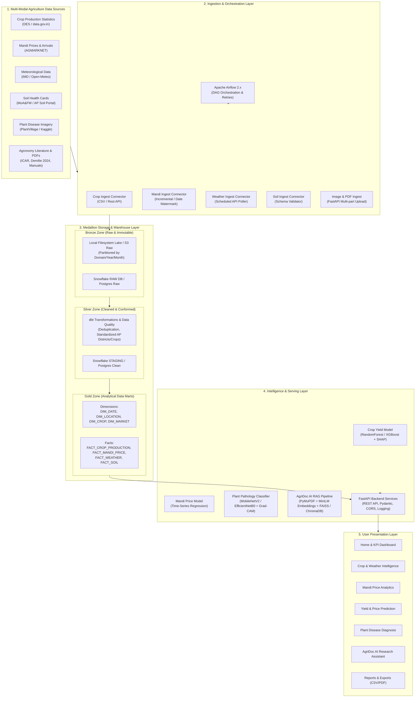
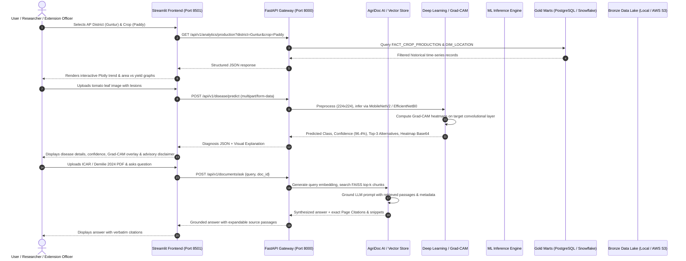
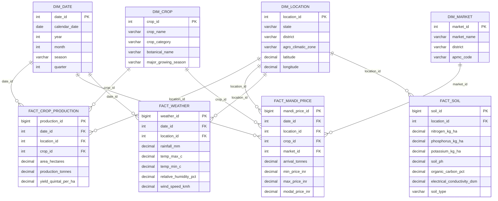

# AgriAI: Smart Agriculture Intelligence Platform
## Complete System Architecture & Technical Design

### 1. Architectural Blueprint
AgriAI is designed as an end-to-end modern data and AI platform, following a decoupled microservices architecture with a Medallion Data Lakehouse, an AI/ML intelligence layer, a Generative AI RAG engine, and a presentation dashboard.

---

### 2. End-to-End Data Flow

---

### 3. Medallion Data Warehouse Architecture

The data architecture organizes information into three distinct zones ensuring data lineage, governance, and auditability:

#### 3.1 Bronze Layer (Raw & Immutable)
- **Purpose**: Capture source data exactly as provided by upstream producers without alteration.
- **Format**: Parquet or raw CSV files partitioned chronologically (`/data/raw/{domain}/year={YYYY}/month={MM}/`).
- **Audit Columns**: Every bronze record carries:
  - `_ingest_id`: UUID generated at extraction time.
  - `_source_system`: Name of source (e.g., `agmarknet_portal`, `data_gov_in_ap`).
  - `_ingested_at`: UTC timestamp of extraction.
  - `_file_checksum`: SHA-256 hash of the ingested payload.

#### 3.2 Silver Layer (Cleaned, Standardized & Conformed)
- **Purpose**: Clean, standardize, and validate data across disparate providers.
- **Transformations Handled**:
  - District name canonicalization (e.g., standardizing "Y.S.R. Kadapa", "Kadapa", "Cuddapah" to `YSR Kadapa`).
  - Crop nomenclature unification (e.g., mapping "Paddy", "Rice", "Dhan" to `Paddy (Dhan)`).
  - Type conversions: dates to ISO-8601 `YYYY-MM-DD`, currency to `DECIMAL(10, 2)`, quantities to metric units (`hectares`, `metric tonnes`, `quintals`).
  - Data quarantine: Records violating domain sanity checks (e.g., `min_price > max_price` or `production < 0`) are written to an isolated quarantine table with error taxonomy tags.

#### 3.3 Gold Layer (Dimensional Star Schema)
- **Purpose**: Business-ready, high-performance analytical marts optimized for analytical slicing, reporting, and ML feature stores.

---

### 4. Dual-Deployment Strategy (Local vs Cloud)

| Capability | Local Development Environment | Cloud Production Environment |
| :--- | :--- | :--- |
| **Relational / Warehouse DB** | PostgreSQL 16 (Local / Docker) | Snowflake (Cloud Analytics Warehouse) |
| **Object Lake Storage** | Local directory (`data/raw/`) or MinIO S3 API | AWS S3 Bucket (`s3://agriai-data-lake-prod/`) |
| **Transformations** | dbt Core (`dbt-postgres`) / Python scripts | dbt Core (`dbt-snowflake`) |
| **Pipeline Orchestrator** | Apache Airflow in Docker Compose | Managed Airflow (AWS MWAA or Cloud Docker) |
| **Vector DB** | FAISS CPU / ChromaDB local file store | ChromaDB Server / Milvus / Pinecone |
| **Application Layer** | FastAPI + Streamlit on localhost | AWS ECS / EKS / Cloud Run or EC2 |

The codebase uses abstract factory interfaces for Storage and Database drivers. When cloud environment credentials (`SNOWFLAKE_ACCOUNT`, `AWS_ACCESS_KEY_ID`) are absent, the application gracefully initializes its PostgreSQL/Local-File driver without throwing runtime exceptions.

---

### 5. AI/ML and Generative AI Architectural Pipeline

#### 5.1 Machine Learning Pipelines
- **Crop Yield Predictor**:
  - Inputs: `crop_name`, `district`, `season`, `area_hectares`, `rainfall_mm`, `temp_avg_c`, `nitrogen`, `phosphorus`, `potassium`, `soil_ph`.
  - Feature Engineering: One-hot/target encoding for categorical inputs, standard scaling for numeric features, temporal feature indicators.
  - Algorithms: Random Forest Regressor and XGBoost Regressor with cross-validated hyperparameter optimization.
  - Explainability: TreeSHAP computes global summary plots and local force plots explaining positive and negative feature contributions.
- **Mandi Price Forecaster**:
  - Time-series windowing with rolling 7-day, 14-day, and 30-day price lags and arrival volume indicators to forecast future modal prices.

#### 5.2 Deep Learning Foliage Pathology Pipeline
- **Backbone Architectures**:
  - **MobileNetV2**: 3.5M parameters, depthwise separable convolutions, ideal for resource-constrained field deployment.
  - **EfficientNetB0**: 5.3M parameters, compound coefficient scaling balancing depth, width, and resolution.
- **Literature Alignment**: Implements the comparative methodology outlined by Demilie (2024), comparing macro-accuracy, precision, recall, F1, inference latency, and memory footprints.
- **Visual Saliency**: Grad-CAM captures gradients flowing into the final convolutional layer (e.g., `features.18` in MobileNetV2 or `conv_head` in EfficientNetB0) to generate a high-contrast heatmap over diseased leaf regions.

#### 5.3 AgriDoc AI (Grounded RAG Pipeline)
- **Ingestion**: PyMuPDF extracts text page-by-page, attaching metadata `{document_name, page_number, total_pages}`.
- **Chunking**: RecursiveCharacterTextSplitter with chunk size 600 characters and 100 character overlap.
- **Embeddings**: SentenceTransformers `all-MiniLM-L6-v2` generating 384-dimensional dense vectors.
- **Vector Search**: FAISS IndexFlatIP (Cosine similarity) or ChromaDB returning top-k passages with similarity score thresholds.
- **Synthesis & Anti-Hallucination**: Prompt template instructing the LLM to reply strictly from supplied context and format bracketed citations `[Document: <name>, Page: <page_no>]`.
