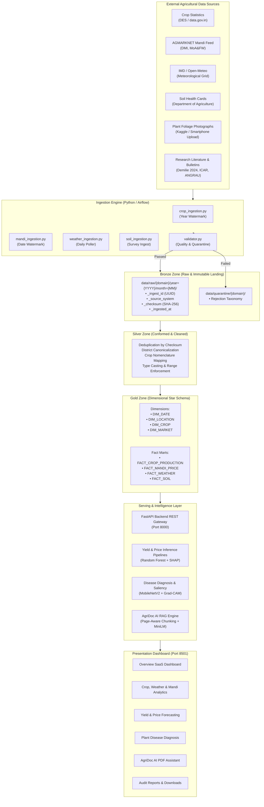

# AgriAI: End-to-End Data Flow Architecture

## 1. Overview & Data Flow Diagram

The AgriAI platform processes agricultural data through a structured Medallion pipeline. Information moves from heterogeneous external sources into partitioned Bronze object storage, through conformed Silver staging tables, into Gold dimensional star schema marts, and finally to predictive ML pipelines, deep learning vision models, Generative AI RAG indices, and interactive dashboard interfaces.



---

## 2. Ingestion to Landing Data Movement

### 2.1 Crop Production Data Flow
1. **Extraction**: `ingestion/crop_ingestion.py` extracts district crop statistics. If full load is disabled, queries are filtered against `high_watermark` stored in `data/watermarks.json`.
2. **Validation**: `validator.py` checks that cultivated area $> 0$, production $\ge 0$, and crop year is between 2000 and 2030.
3. **Quarantine Routing**: Records failing constraints are tagged with `_rejection_reasons` and written to `data/quarantine/crop_production/`.
4. **Bronze Storage**: Valid records are enriched with `_ingest_id`, `_batch_id`, `_source_system`, and `_ingested_at`, then saved to `data/raw/crop_production/year={YYYY}/month={MM}/`.

### 2.2 Mandi Wholesale Price Data Flow
1. **Extraction**: `ingestion/mandi_ingestion.py` extracts transactions for APMC markets (Guntur, Kurnool, Vijayawada, Adoni, Tirupati, Rajahmundry).
2. **Watermarking**: High-watermark tracks `MAX(arrival_date)`. Subsequent extraction pulls only newer dates.
3. **Business Sanity Enforcement**: Enforces `min_price <= modal_price <= max_price` and positive prices. Offending records are diverted to quarantine.
4. **Bronze Storage**: Immutably saved in partitioned raw lake storage.

### 2.3 Meteorological Observations Data Flow
1. **Extraction**: `ingestion/weather_ingestion.py` queries weather station grid centroids across Andhra Pradesh districts.
2. **Range Verification**: Checks that minimum temperature $\le$ maximum temperature, rainfall $\ge 0$, and relative humidity is within $[0, 100]\%$.
3. **Bronze Storage**: Saved to `data/raw/weather/year={YYYY}/month={MM}/`.

---

## 3. Transformation & Warehousing Flow (Bronze -> Silver -> Gold)

```
[data/raw/ Partitioned Lake]
          │
          ▼
[Silver Staging Tables]
  ├── Canonical District Mapping ("e. godavari", "E Godavari" ➔ "East Godavari")
  ├── Canonical Crop Mapping ("Rice", "Dhan" ➔ "Paddy (Rice)")
  ├── SHA-256 Checksum Deduplication
  └── Type Casting (ISO Dates, Float Metrics)
          │
          ▼
[Gold Star Schema Dimensional Marts]
  ├── DIM_DATE (date_id, calendar_date, year, month, quarter, season)
  ├── DIM_LOCATION (location_id, state, district, agro_climatic_zone)
  ├── DIM_CROP (crop_id, crop_name, crop_category, major_growing_season)
  ├── DIM_MARKET (market_id, market_name, district, apmc_code)
  ├── FACT_CROP_PRODUCTION (production_id, date_id, location_id, crop_id, area, production, yield)
  ├── FACT_MANDI_PRICE (mandi_price_id, date_id, location_id, crop_id, market_id, prices, arrivals)
  ├── FACT_WEATHER (weather_id, date_id, location_id, temps, rainfall, humidity, wind)
  └── FACT_SOIL (soil_id, location_id, N, P, K, pH, OC, EC, soil_type)
```

---

## 4. Serving & Inference Flow

- **Analytical Queries**: Streamlit UI calls `FastAPI` endpoints (`/analytics/crops`, `/analytics/mandi-prices`, `/analytics/weather`, `/analytics/soil`), which query Gold analytical marts.
- **Yield ML Inference**: Features (`crop`, `district`, `season`, `area`, `rainfall`, `temp`, `soil_ph`, `N`, `P`, `K`) are passed to the trained `RandomForestRegressor` pipeline, returning predicted yield (Q/Ha), total production (Tonnes), and TreeSHAP attribution scores.
- **Disease CV Inference**: Leaf images are resized ($224 \times 224$), normalized with ImageNet statistics, inferred via `MobileNetV2` / `EfficientNetB0`, and Grad-CAM saliency heatmaps are generated from the final convolutional feature layer.
- **AgriDoc AI RAG**: Questions generate dense embeddings ($384$ dims), retrieve top-k semantic chunks from `AgriVectorStore`, ground LLM synthesis, and format exact citations ($[Document, Page]$).
