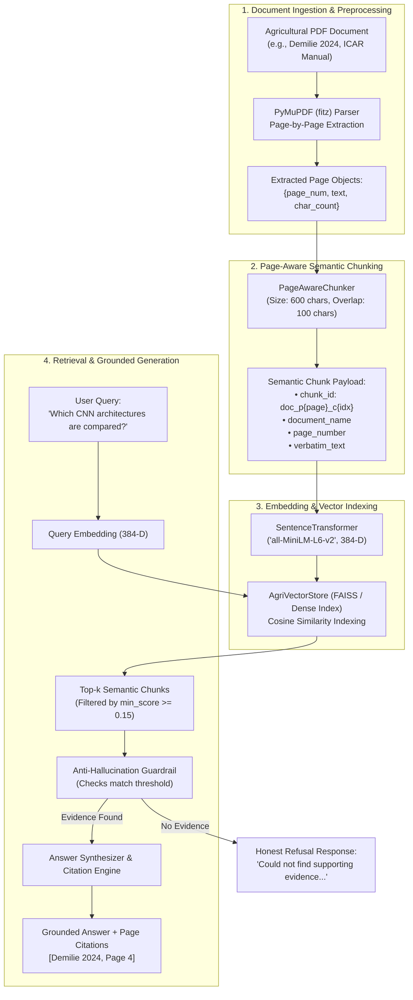

# AgriDoc AI: PDF Intelligence & Research Assistant RAG Architecture

## 1. System Vision & Objective
**AgriDoc AI** is an advanced Retrieval-Augmented Generation (RAG) system tailored specifically for agricultural literature, including peer-reviewed research papers (such as Demilie, 2024), government extension bulletins, ICAR agronomic packages of practices, and Soil Health Card guidelines.

The system's core design mandates:
1. **Multi-Document Ingestion**: Seamless ingestion of multi-page PDF documents.
2. **Page-Aware Lineage**: Preserving exact physical page numbers across text extraction and vector chunking.
3. **Dense Vector Search**: Semantic retrieval using 384-dimensional dense embeddings (`all-MiniLM-L6-v2`) and cosine similarity.
4. **Anti-Hallucination Guardrails**: Strictly conditioning answer synthesis on retrieved passages and explicitly refusing to fabricate answers when supporting evidence is absent.
5. **Granular Citations**: Presenting Document Name, Page Number, Relevance Score, and verbatim extracted passages alongside every generated answer.

---

## 2. End-to-End RAG Pipeline Architecture



---

## 3. Detailed Component Specifications

### 3.1 Document Extraction (`ai/pdf_processor.py`)
- Employs **PyMuPDF (`fitz`)** for high-speed page-by-page extraction.
- Preserves raw textual formatting, removes running headers/footers where appropriate, and detects scanned/image-only pages.
- Generates structured page payloads:
  ```json
  {
    "page_number": 4,
    "text": "Deep Learning Architectures: Convolutional Neural Networks (CNNs)...",
    "char_count": 842,
    "is_scanned": false
  }
  ```

### 3.2 Page-Aware Semantic Chunking (`ai/chunking.py`)
- Standard text splitters discard page metadata during paragraph windowing. `PageAwareChunker` operates strictly within each page boundary to ensure that every chunk carries an unambiguous, verifiable page number.
- **Chunk Size**: 600 characters ($\approx 90$–$110$ words).
- **Chunk Overlap**: 100 characters to prevent loss of semantic context across sentence boundaries.
- **Unique Identifier**: Formatted as `{document_id}_p{page_number}_c{chunk_index}`.

### 3.3 Semantic Embeddings & Vector Storage (`ai/embeddings.py` & `ai/vector_store.py`)
- **Model**: `sentence-transformers/all-MiniLM-L6-v2`.
- **Dimensionality**: 384 dense floating-point dimensions.
- **Similarity Metric**: Normalized Inner Product (Cosine Similarity):
  $$\text{Cosine Similarity}(u, v) = \frac{u \cdot v}{\|u\| \|v\|}$$
- **Indexing**: `AgriVectorStore` maintains an in-memory matrix normalized to unit length for sub-millisecond retrieval latency.

### 3.4 Citation Generation (`ai/citations.py`)
- Formats structured citations adhering to academic verification standards:
  - `document_name`: Full filename of the source document.
  - `page_number`: Exact physical page number where the passage appears.
  - `chunk_index`: Position of the chunk in the document flow.
  - `relevance_score`: Cosine similarity score between query and chunk.
  - `verbatim_snippet`: Exact text excerpt for immediate user validation.

---

## 4. Anti-Hallucination Guardrails & Refusal Protocol

Generative AI models in agriculture must never fabricate biological dosages, pesticide recommendations, or agronomic claims. AgriDoc AI implements a three-tier anti-hallucination defense:
1. **Stopword & Keyword Cleaning**: Query terms are stripped of common grammatical stopwords before matching to prevent spurious high similarity scores caused by filler words ("the", "that", "for").
2. **Relevance Thresholding**: Chunks scoring below $\text{min\_score} = 0.15$ are filtered out.
3. **Empty Retrieval Handling**: If no passages pass the threshold, the system returns a polite, transparent refusal without invoking LLM creative completion:
   > *"I could not find relevant supporting evidence in the uploaded agricultural documents to answer your query. Please verify your query keywords or upload additional reference documents to the knowledge base."*
